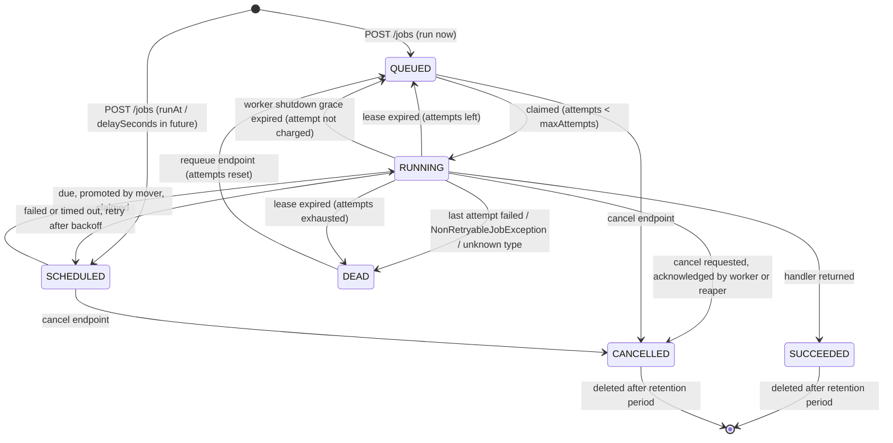

# Distributed Job Scheduler

A distributed background-job system built with Spring Boot 4 and Java 25.

- **PostgreSQL** is the source of truth for every job and schedule.
- **Redis** sorted sets act as the queue, so workers can pull jobs quickly and by priority.
- **API** and **worker** run as separate profiles of the same jar and scale independently.
- Every RUNNING job holds a **lease** (database clock) plus a **fencing token**. Crashed, stuck or partitioned workers are recovered when their lease expires, and a stale worker can never overwrite a newer result.
- The system also recovers from hung handlers, Redis data loss and partial writes.
- Delivery is **at-least-once**.

Features: priorities, retries with exponential backoff and jitter, a dead-letter queue, per-job timeouts, delayed jobs, recurring (cron) schedules, idempotent submission, cancellation, paginated listing, retention, API-key auth, rate limiting, Prometheus metrics, a Grafana dashboard, and Swagger UI.

---

## Contents

- [Architecture](#architecture)
- [Job state machine](#job-state-machine)
- [Delivery guarantee](#delivery-guarantee)
- [Failure scenarios handled](#failure-scenarios-handled)
- [Design trade-offs](#design-trade-offs)
- [Quick start (Docker Compose)](#quick-start-docker-compose)
- [PulseCheck](#pulsecheck)
- [Web app (frontend)](#web-app-frontend)
- [Project structure](#project-structure)
- [Running from an IDE](#running-from-an-ide)
- [Configuration reference](#configuration-reference)
- [API reference](#api-reference)
- [Observability](#observability)
- [Testing](#testing)
- [Results](#results)
- [Monitoring](#monitoring)
- [Known limitations](#known-limitations)

---

## Architecture


**How a job flows through the system**

1. `POST /jobs` inserts a row (`QUEUED`, or `SCHEDULED` if `runAt` is in the future), then adds the id to `queue:ready` or `queue:delayed`.
2. Each worker thread blocks on `BZPOPMIN queue:ready` (2 s timeout, so it notices shutdown).
3. The worker **claims** the job with a conditional update: `status IN (QUEUED, SCHEDULED) AND attempts < max_attempts`. The update increments `attempts` and sets `worker_id`, a fresh `lease_token` and `lease_expires_at`. If 0 rows change, another worker won and this one moves on.
4. The handler runs on a virtual thread under a per-job timeout. While it runs, the worker renews the lease every 10 s (`worker.lease-renew-interval`; the lease itself is 30 s, computed with the database clock) and checks every second whether a cancel was requested.
5. The result is written with an update that is conditional on `status = RUNNING`, the same `worker_id` **and** the same `lease_token`. A worker that lost the job in the meantime cannot overwrite it.
6. On failure the job becomes `SCHEDULED` with `run_at = now + backoff` and goes into `queue:delayed`. A single lock-guarded mover promotes due entries to `queue:ready` with one atomic Lua script.

Redis key layout:

| Key | Type | Contents |
|---|---|---|
| `queue:ready` | ZSET | job id, score = `priority × 10¹³ + enqueue-ms`; lower pops first (priority 1 = highest) |
| `queue:delayed` | ZSET | job id, score = run-at ms |
| `queue:delayed:priority` | HASH | job id → priority, so promotion needs no DB lookup |
| `queue:dead` | LIST | ids of DEAD jobs (informational; the DB is authoritative) |
| `worker:{id}` | STRING, TTL 15 s | heartbeat, refreshed every 5 s; visibility and metrics only, never a recovery trigger |
| `job:cancel:{id}` | STRING, TTL | fast-path cancel hint for RUNNING jobs |
| `lock:*` | STRING, TTL | leases for singleton tasks (reaper sweeps, mover, retention) |
| `ratelimit:submit:{key}` | HASH | token bucket per API key |

## Job state machine



`SUCCEEDED`, `DEAD` and `CANCELLED` are terminal. The `ck_jobs_status` CHECK constraint keeps the database values in sync with `JobStatus`.

## Delivery guarantee

Delivery is **at-least-once**. A job that is accepted (`201`) will eventually run to `SUCCEEDED` or end up `DEAD`/`CANCELLED`, but **a handler may run more than once for the same job**. This happens when:

- a worker finishes the handler but dies before writing `SUCCEEDED`;
- a lease expires while a slow, partitioned or paused worker is still running the handler;
- a worker cannot reach Postgres for longer than its lease (30 s) while its handler keeps running.

**Handlers must be idempotent.** For example, use the job id as an idempotency key towards downstream systems, or check whether the side effect already happened.

What the system does guarantee: **at most one result is recorded per attempt**, and a worker whose claim was superseded can never overwrite a newer state. The `lease_token` fencing token makes this hold even when a restarted process reuses the same worker id.

## Failure scenarios handled

| Scenario | What happens | Bounded by |
|---|---|---|
| **Worker crash** (SIGKILL, OOM, host loss) | The worker stops renewing its leases. The reaper (every 10 s, Redis-locked) finds RUNNING jobs whose `lease_expires_at < now()` (database clock) and re-queues them with a conditional update (`status = RUNNING AND worker_id AND lease_token AND lease still expired`). A job that finished, or whose lease was renewed, in the meantime is never touched. The heartbeat only labels the cause (`worker lost (lease expired)`). | lease 30 s + reaper interval 10 s |
| **Poison pill** (job that kills every worker that runs it) | Each crash uses up one attempt, because the claim increments `attempts`. Once `attempts ≥ maxAttempts`, the reaper marks it `DEAD` ("worker lost (lease expired); max attempts exhausted") and `claim()` refuses it. | `maxAttempts` |
| **Hung handler** | Runs under `Future.get(timeout)`. On timeout it is cancelled (interrupted) and treated as a failure with message `timeout` (retry or DEAD); `jobs_timeout_total` counts these. | `timeoutSeconds` (default 300) |
| **Hung / partitioned worker** (alive heartbeat, but not making progress or unable to reach Postgres) | The lease stops being renewed. Recovery is driven by lease expiry alone, so the reaper re-queues the job even though the heartbeat is alive. If the old worker comes back, its completion fails the fencing check and it stops its handler. | `worker.lease-seconds` (30) |
| **Redis wipe / failover without persistence** | Postgres is authoritative. The drift sweeper finds QUEUED/SCHEDULED jobs that are missing from both ZSETs and re-enqueues them at their `run_at`. It pages by id, checks each page with one Lua call, waits once, re-checks, and uses a conditional "touch" before each re-enqueue. Losing the `worker:*` heartbeat keys does **not** trigger any recovery, because recovery is lease-based. AOF (`--appendonly yes`) makes plain restarts lossless. | `sweeper.stale-after` (60 s) + sweep interval |
| **API crash between DB commit and `ZADD`** | The row exists but is not in Redis. The drift sweeper picks it up once it is older than `stale-after`. The schedule runner has the same window and is covered the same way. | ~60–70 s |
| **Worker dies between `BZPOPMIN` and claim** | Same as above: the job is still QUEUED in Postgres but gone from Redis, so the sweeper restores it. | ~60–70 s |
| **Duplicate pop** (same id in Redis twice, two workers pop it) | Only one conditional `claim` can succeed; the other is a no-op (`jobs_duplicate_skipped_total`). | — |
| **Reaper racing a worker** (reads RUNNING, the worker then succeeds) | The reaper's update requires the state it read (RUNNING, same worker and token), so it changes 0 rows and does nothing. | — |
| **Rolling deploy / scale-down** (SIGTERM) | `WorkerLoop` (a `SmartLifecycle`) stops polling immediately and lets in-flight jobs run for `shutdown-grace-seconds` (25 s). After that it interrupts them and puts them back to QUEUED **without charging the attempt**. Draining jobs keep renewing their leases, so the reaper never requeues them mid-drain. Compose allows `stop_grace_period: 30s`. | 25 s |
| **Duplicate submission** (client retry) | `Idempotency-Key` header: the unique column plus `INSERT … ON CONFLICT DO NOTHING` returns the original job with `200`. | — |
| **Two API instances firing the same cron** | `SELECT … FOR UPDATE SKIP LOCKED` on due schedules, plus the per-fire idempotency key `schedule:{id}:{fireTime}`. | — |

## Design trade-offs

**Why a Redis sorted set rather than Postgres `SELECT … FOR UPDATE SKIP LOCKED` as the queue?**

| | Redis ZSET (chosen) | Postgres SKIP LOCKED |
|---|---|---|
| Dequeue | `BZPOPMIN` blocks and wakes instantly: no polling and no load on the DB while idle | Workers must poll; each poll is a query plus a row lock |
| Priority + FIFO | One score, O(log n) | Index on `(status, priority, run_at)`; fine, but it churns |
| Delayed jobs | Second ZSET plus an atomic Lua mover | `run_at <= now()` in the poll query (simpler) |
| Hot-path DB load | One conditional `UPDATE` per claim | `SELECT … FOR UPDATE` + `UPDATE`, plus bloat and vacuum pressure on a hot table |
| Consistency | **Two systems** that can drift, so a drift sweeper is needed and delivery is at-least-once | Enqueue is transactional with the business write: no drift and no sweeper |
| Operations | Extra stateful service (AOF, memory sizing) | Nothing new |

The Redis design is chosen to keep the dequeue path off Postgres and to show the recovery mechanics. Honestly, for modest throughput (hundreds of jobs per second) SKIP LOCKED alone would be simpler and fully transactional. That is why the **schedule runner** uses SKIP LOCKED: it has low volume and needs exactly-once fires.

Other choices:

- **Fencing token instead of `attempts`.** `attempts` is decremented when a shutdown hands a job back, so it can repeat. A random UUID per claim cannot.
- **Lease as the single recovery authority.** A RUNNING job is recovered only when its lease (30 s, renewed every 10 s) has expired by the **database clock**. That one rule covers crashed, stuck and partitioned workers alike, and it means losing Redis heartbeats can never cause a requeue. The heartbeat (`worker:{id}`) remains for the `workers_alive` gauge and to label recoveries. The trade-off is slower crash detection (up to ~40 s instead of ~25 s).
- **Cooperative cancellation.** Java cannot safely kill a thread. A RUNNING job is interrupted, and the handler must respond to interrupts. Lease renewal is refused while `cancel_requested` is set, so the worker notices even if the Redis hint is lost.
- **Full-jitter backoff** (`random(0, min(cap, base·2^attempt))`). This spreads out jobs that failed together, for example during a downstream outage.
- **Retries are `SCHEDULED`** because they are future-dated, which keeps the state machine uniform.
- **Misfire policy for cron: run once, skip missed runs.** After downtime, a schedule fires once (for the earliest missed time). It does not replay a backlog.

## Quick start (Docker Compose)

```bash
cp .env.example .env        # then edit every "change-me" value
docker compose up -d --build --scale worker=3
```

| Service | URL | Notes |
|---|---|---|
| PulseCheck website | http://localhost:8080 | the React app, served by the API container |
| API | http://localhost:8080 | `/jobs`, `/schedules`: send `X-API-Key: <one of API_KEYS>`; `/api`: PulseCheck sessions |
| Swagger UI | http://localhost:8080/swagger-ui.html | click **Authorize** and enter an API key |
| Prometheus | http://127.0.0.1:9090 | bound to localhost only |
| Grafana | http://127.0.0.1:3000 | `GRAFANA_ADMIN_USER` / `GRAFANA_ADMIN_PASSWORD`; *Job Scheduler* dashboard is provisioned |

```bash
curl -s -X POST localhost:8080/jobs -H "X-API-Key: $API_KEY" -H 'Content-Type: application/json' \
     -d '{"type":"EMAIL","payload":"hello","priority":1}'
```

Postgres, Redis and the API's actuator port (9091) are **not published** to the host. To reach them, edit `docker-compose.override.yml` (Compose merges it automatically).

> **Upgrading an existing deployment:** `POSTGRES_PASSWORD` only takes effect when the `pgdata` volume is first created. If you already have a volume from the old setup (password `jobs`), either set `POSTGRES_PASSWORD=jobs` in `.env` or recreate the volume. Flyway applies migrations V2–V4 on startup.

## PulseCheck

**PulseCheck** is a website uptime monitor for non-technical users, built on top of this scheduler. The scheduler is the engine: each monitor is a recurring `HTTP_CHECK` schedule, and every check is an ordinary job, with the same retries, leases and recovery.

**Status:** complete end to end. The backend has user accounts, monitors, HTTP checks, status, incidents, uptime, SSRF protection, and real emails (verification, password reset, DOWN/UP alerts, alert-recipient confirmations) sent through [Resend](https://resend.com). The [web app](#web-app-frontend) covers everything a website owner needs, with no API calls by hand.

**Using the website** (http://localhost:8080 with Docker Compose)

1. **Sign up**, then click the link in the verification email (with the default `logging` email provider, the link is in the worker log: `docker compose logs worker | grep verify-email`).
2. **Add a website** from the dashboard: type an address like `example.com` (PulseCheck adds `https://`), an optional name, and how often to check. The first check runs straight away and the page shows it arriving.
3. **The dashboard** shows a card per website: status (Up, Down, Checking or Paused), uptime and average response time for the last 24 hours, and when it was last checked. Down websites come first. It refreshes every 30 seconds.
4. **A website's page** has its address (opens in a new tab), uptime for 24 hours, 7 days and 30 days, a response-time chart for the last 24 hours or 7 days, its outages ("Down for 12 minutes", with the cause in plain words), recent checks, and who gets alert emails. From there you can **edit**, **pause/resume** or **delete** it, and **add up to 5 people** to its alerts (they confirm by email first), resend their confirmation or remove them.
5. **Account settings** (menu at the top right): change password or delete the account.

Times are shown in your own time zone. The website is keyboard- and screen-reader-accessible (checked with axe-core) and runs under a strict Content-Security-Policy.

**How monitoring works**

- A monitor checks one URL every 60, 300, 900 or 3600 seconds (at most 10 monitors per user, no duplicate URLs). Creating one runs a first check immediately.
- A check is **up** for any 2xx/3xx response (up to 5 redirects followed) and **down** for anything else, a 10 s timeout, or a connection error.
- A monitor turns **DOWN** after 2 failed checks in a row and **UP** again after 1 success. Going DOWN opens an **incident** (starting at the first failed check); coming back UP resolves it. Retries can never create duplicate incidents.
- `GET /api/monitors/{id}` includes uptime for the last 24 h, 7 d and 30 d, plus the average response time.
- **SSRF protection:** only public http(s) URLs can be monitored. Every address a host resolves to must be public (private, loopback, link-local/cloud-metadata, CGNAT and similar ranges are refused). The check connects only to the address that was validated, so DNS rebinding can't redirect it, and every redirect hop is validated again.

**Alerts**

- When a monitor goes **DOWN**, PulseCheck emails "*Shop* is DOWN" with the URL, the time (in UTC), the cause (e.g. `HTTP 500`, a timeout) and a link to the monitor. When it comes back, it emails "*Shop* is back UP after 12 minutes".
- Each DOWN and UP is emailed **exactly once**, even if checks are retried or a worker crashes: the alert is queued in the same database transaction that opens or closes the incident.
- **Flapping:** at most 6 alert emails per monitor per hour. The 6th is a single "alerts paused for this monitor for an hour" note; later changes are skipped (and logged) until the hour is over.
- **Who gets alerts:** your account's address once it is verified, plus up to 5 **extra recipients** per monitor. Each extra address is sent a confirmation email first and gets alerts only after clicking "Yes, send me alerts" (double opt-in). Confirmation emails are limited to 10 per account per hour and 3 per address per day.
- **Every alert has an unsubscribe link**, plus the `List-Unsubscribe` headers that give Gmail and others a one-click Unsubscribe button. It needs no login and stops only that address's alerts for that one monitor. Your own alerts for a monitor can be turned back on from its page ("Send me alerts again"), or with `PATCH /api/monitors/{id}` `{"notifyOwner": true}`.
- Emails are sent by the workers as ordinary `SEND_EMAIL` jobs, with retries. One-time links are stored only as hashes, and the link token inside an email job is deleted from the job as soon as it is sent.

**Accounts and security**

- **Sign up** with email and password (10–128 characters, hashed with Argon2id), then **verify the email** through the emailed link before creating monitors. Sign-up gives the same answer for an email that is already registered, so it can't be used to find out who has an account.
- **Log in** to get a session cookie (`PULSECHECK_SESSION`: HttpOnly, SameSite=Lax, Secure except on localhost). Sessions live in Redis: 1 day idle, or 30 days with `"rememberMe": true`. Logging in always issues a new session id.
- **CSRF:** every `POST`/`PATCH`/`DELETE` under `/api` needs the value of the `XSRF-TOKEN` cookie in an `X-XSRF-TOKEN` header. `GET /api/auth/csrf` sets the cookie. A browser app should read the cookie right before each request, because it changes at login and logout.
- **Each user sees only their own data:** someone else's monitor answers 404, exactly like one that doesn't exist.
- **Brute-force protection:** login 10/min per IP and 5/min per email, sign-up 5/hour per IP (`429` + `Retry-After`). 10 wrong passwords in a row lock the account for 15 minutes. Every login failure says "Invalid email or password".
- **Password reset** links last 1 hour and log out all of the user's sessions. Verification links last 24 hours. Both work once, and only a hash of each is stored.
- `/api/**` uses these accounts only: the scheduler's `X-API-Key` does not work there, and `/jobs/**` and `/schedules/**` still use only the API key.

Design decisions, including exactly how a frontend must handle CSRF, are in [docs/DESIGN.md](docs/DESIGN.md#pulsecheck).

**Account endpoints**

| Method & path | Who | Description |
|---|---|---|
| `GET /api/auth/csrf` | anyone | Sets the `XSRF-TOKEN` cookie; returns the header name and token |
| `POST /api/auth/signup` | anyone | `{email, password}`; sends the verification link |
| `POST /api/auth/verify` | anyone | `{token}` from the verification link |
| `POST /api/auth/login` | anyone | `{email, password, rememberMe?}`; starts a session |
| `POST /api/auth/demo` | anyone | Demo mode only (404 otherwise): creates a private 3-hour sandbox with 2 sample monitors and logs in to it; 20/hour per IP; `503` `demo_busy` when 20 are in use |
| `GET /api/config` | anyone | `{demoEnabled, signupOpen}` for the web app |
| `POST /api/auth/forgot-password` | anyone | `{email}`; always the same answer |
| `POST /api/auth/reset-password` | anyone | `{token, newPassword}`; logs out every session |
| `GET /api/auth/me` | anyone | The current user, with `monitorLimit`, `minIntervalSeconds`, `demo` and `demoExpiresAt` (for a demo sandbox) and `demoEnabled`/`signupOpen`; `204 No Content` when nobody is logged in |
| `POST /api/auth/logout` | logged in | Ends the session |
| `POST /api/auth/resend-verification` | logged in | New verification link (3/hour) |
| `POST /api/auth/change-password` | logged in | `{currentPassword, newPassword}`; logs out other sessions |
| `DELETE /api/auth/account` | logged in | `{password}`; deletes the account, its monitors and all their data |

**Monitor endpoints** (logged in; creating needs a verified email)

| Method & path | Description |
|---|---|
| `POST /api/monitors` | Create: `name`, `url`, `intervalSeconds` (60/300/900/3600), optional `notifyOwner` (default `true`) |
| `GET /api/monitors` | List my monitors, each with `notifyOwner`, its `recipients` (email + `PENDING`/`CONFIRMED`/`UNSUBSCRIBED`) and its last-24 h `uptime` (`last24h`, `avgResponseMs24h`, `checks24h`; `last7d`/`last30d` are null here) |
| `GET /api/monitors/{id}` | One monitor, with its recipients and uptime summary |
| `PATCH /api/monitors/{id}` | Change name, URL, interval or `notifyOwner`. Changing the URL closes any open incident without an UP alert |
| `POST /api/monitors/{id}/pause`, `/resume` | Stop / restart checks |
| `DELETE /api/monitors/{id}` | Delete the monitor, its history and its schedule |
| `GET /api/monitors/{id}/checks?from=&to=&page=&size=` | Check history, newest first (`from`/`to` are ISO-8601) |
| `GET /api/monitors/{id}/incidents?page=&size=` | Incidents, newest first, each with `durationSeconds`, `ongoing` and `cause` |
| `GET /api/monitors/{id}/response-times?range=24h\|7d` | Response times for a chart, bucketed in SQL: 5-minute buckets for `24h` (default), 1-hour for `7d`; every bucket listed oldest first with `checks`, `failures`, `avgResponseMs` and `maxResponseMs` (averages of successful checks; null when there were none) |
| `POST /api/monitors/{id}/recipients` | `{email}`: add an extra recipient (max 5); sends them a confirmation email |
| `POST /api/monitors/{id}/recipients/{rid}/resend` | New confirmation email for a pending recipient (the old link stops working) |
| `DELETE /api/monitors/{id}/recipients/{rid}` | Remove a recipient |

**Links in emails** (no login; opening the link shows a page with a button, only the button acts)

| Path | Description |
|---|---|
| `/alert-recipients/confirm?token=` | Confirm an extra recipient |
| `/alert-recipients/unsubscribe?token=` | Stop alerts for one monitor; also the one-click `List-Unsubscribe` target |

The verification and password-reset links open `/verify-email` and `/reset-password` in the web app (at `PULSECHECK_APP_BASE_URL`), and "View monitor" in alerts opens the website's page.

**Sending real email**

By default (`PULSECHECK_EMAIL_PROVIDER=logging`) emails are written to the **worker** log instead of being sent; that is only allowed while `PULSECHECK_APP_BASE_URL` is a localhost URL. To send real email, set in `.env` and restart with `docker compose up -d --build --force-recreate api worker`:

```bash
PULSECHECK_EMAIL_PROVIDER=resend
RESEND_API_KEY=re_...
EMAIL_FROM=PulseCheck <onboarding@resend.dev>
```

With Resend's shared test sender `onboarding@resend.dev`, emails are only delivered to the address of your own Resend account. To email anyone, send from your own domain:

1. In Resend, **Domains → Add domain**, preferably a subdomain such as `mail.example.com` so your main domain's email reputation is kept separate.
2. Add the DNS records Resend shows at your DNS provider:
   - **SPF** (a `TXT` record, plus an `MX` record for the bounce subdomain): lists the servers allowed to send for the domain.
   - **DKIM** (a `TXT` record at `resend._domainkey...`): a public key, so receivers can check each email's signature really comes from your domain and wasn't changed.
   - **DMARC** (optional but recommended; a `TXT` record at `_dmarc.example.com`): tells receivers what to do with mail that fails SPF/DKIM. Start with `v=DMARC1; p=none; rua=mailto:dmarc@example.com` to collect reports, then move to `p=quarantine` once everything passes.
3. Wait for Resend to show the domain as **Verified** (minutes to a few hours, depending on DNS).
4. Change `EMAIL_FROM` to an address on that domain, e.g. `PulseCheck <alerts@mail.example.com>`, set `PULSECHECK_APP_BASE_URL` to the app's public `https://` URL, and restart the API and workers.

**Try it** (with the Compose stack running; needs `curl`, `jq` and `awk`)

Each user gets a curl cookie jar, which plays the part of the browser. `xsrf` reads the current CSRF token from a jar. (Sign-up is limited to 5 per hour per IP address; if you repeat the walkthrough with new emails several times, wait or expect a `429`.)

```bash
xsrf() { awk '$6=="XSRF-TOKEN"{t=$7} END{print t}' "$1"; }
ALICE=$(mktemp)
BOB=$(mktemp)
```

Alice gets a CSRF cookie and signs up:

```bash
curl -s -c $ALICE -b $ALICE localhost:8080/api/auth/csrf
curl -s -c $ALICE -b $ALICE -H "X-XSRF-TOKEN: $(xsrf $ALICE)" -H 'Content-Type: application/json' \
  -d '{"email":"alice@example.com","password":"alice-long-password"}' localhost:8080/api/auth/signup
```

Read the verification email from the worker log (with the default `logging` provider; wait a second or two for a worker to send it), take the token from its link, and verify:

```bash
docker compose logs worker --no-log-prefix --since 10m | grep '"EMAIL to=alice@example.com' | tail -1 | jq -r .message
TOKEN=$(docker compose logs worker --no-log-prefix --since 10m | grep '"EMAIL to=alice@example.com' | tail -1 | jq -r .message | grep -o 'token=[A-Za-z0-9_-]*' | cut -d= -f2)
curl -s -c $ALICE -b $ALICE -H "X-XSRF-TOKEN: $(xsrf $ALICE)" -H 'Content-Type: application/json' \
  -d "{\"token\":\"$TOKEN\"}" localhost:8080/api/auth/verify
```

Log in, create a monitor and look at it (wait a few seconds for the first check):

```bash
curl -s -c $ALICE -b $ALICE -H "X-XSRF-TOKEN: $(xsrf $ALICE)" -H 'Content-Type: application/json' \
  -d '{"email":"alice@example.com","password":"alice-long-password"}' localhost:8080/api/auth/login
MONITOR_ID=$(curl -s -c $ALICE -b $ALICE -H "X-XSRF-TOKEN: $(xsrf $ALICE)" -H 'Content-Type: application/json' \
  -d '{"name":"Example","url":"https://example.com","intervalSeconds":60}' localhost:8080/api/monitors | jq -r .id)
curl -s -b $ALICE localhost:8080/api/monitors/$MONITOR_ID | jq '{name, status, lastCheckedAt, uptime}'
curl -s -b $ALICE "localhost:8080/api/monitors/$MONITOR_ID/checks?size=5" | jq -c '.content[]'
```

Log out; the session no longer works:

```bash
curl -s -c $ALICE -b $ALICE -X POST -H "X-XSRF-TOKEN: $(xsrf $ALICE)" localhost:8080/api/auth/logout
curl -s -b $ALICE localhost:8080/api/auth/me
```

Bob signs up, verifies and logs in the same way, then tries Alice's monitor:

```bash
curl -s -c $BOB -b $BOB localhost:8080/api/auth/csrf
curl -s -c $BOB -b $BOB -H "X-XSRF-TOKEN: $(xsrf $BOB)" -H 'Content-Type: application/json' \
  -d '{"email":"bob@example.com","password":"bob-long-password"}' localhost:8080/api/auth/signup
BTOKEN=$(docker compose logs worker --no-log-prefix --since 10m | grep '"EMAIL to=bob@example.com' | tail -1 | jq -r .message | grep -o 'token=[A-Za-z0-9_-]*' | cut -d= -f2)
curl -s -c $BOB -b $BOB -H "X-XSRF-TOKEN: $(xsrf $BOB)" -H 'Content-Type: application/json' \
  -d "{\"token\":\"$BTOKEN\"}" localhost:8080/api/auth/verify
curl -s -c $BOB -b $BOB -H "X-XSRF-TOKEN: $(xsrf $BOB)" -H 'Content-Type: application/json' \
  -d '{"email":"bob@example.com","password":"bob-long-password"}' localhost:8080/api/auth/login
curl -s -b $BOB localhost:8080/api/monitors
curl -s -b $BOB -o /dev/null -w '%{http_code}\n' localhost:8080/api/monitors/$MONITOR_ID
```

Internal addresses are refused with 400 (as Alice, logged in again):

```bash
curl -s -c $ALICE -b $ALICE -H "X-XSRF-TOKEN: $(xsrf $ALICE)" -H 'Content-Type: application/json' \
  -d '{"email":"alice@example.com","password":"alice-long-password"}' localhost:8080/api/auth/login
curl -s -c $ALICE -b $ALICE -H "X-XSRF-TOKEN: $(xsrf $ALICE)" -H 'Content-Type: application/json' \
  -d '{"name":"metadata","url":"http://169.254.169.254/latest/meta-data/","intervalSeconds":60}' localhost:8080/api/monitors | jq -r .detail
```

What a live run on 2026-11-23 returned:

| Step | Result |
|---|---|
| Sign up Alice | `201`, `emailVerified: false`; verification email with a 24 h link in the API log |
| Create a monitor before verifying | `403 Email not verified` |
| Verify, then create `https://example.com` | `200`, then `201` |
| First check | `UP`, HTTP 200 in 278 ms; uptime 24 h `100.0` |
| Log out, then `GET /api/auth/me` | `204`, then `401 Please log in` |
| Bob: `GET /api/monitors` | `200 []` |
| Bob: Alice's monitor, its checks and incidents; `DELETE` it | `404` for all four; Alice's monitor unchanged |
| `GET /api/monitors` with only the scheduler `X-API-Key` | `401` |

```text
This URL can't be monitored: 169.254.169.254 is a private or reserved address
This URL can't be monitored: localhost resolves to a private or reserved address (127.0.0.1)
```

**Live email run** (2026-11-24, `PULSECHECK_EMAIL_PROVIDER=resend`, sender `onboarding@resend.dev`, a real Gmail inbox). The monitored URL was a raw file in a public GitHub repo, deleted to make it return 404 and re-created to make it return 200, so the monitor itself was never edited. (`raw.githubusercontent.com` caches for up to 5 minutes, 404s included, so changes show up with a delay.)

| Time (UTC) | Event | Result |
|---|---|---|
| 04:46:57 | Sign up | Verification email accepted by Resend on the first attempt; token pasted into `POST /api/auth/verify` |
| 04:48:10 | Create monitor, 60 s interval | First check `UP`, HTTP 200 in 377 ms |
| 05:04:22 | `status.txt` deleted (commit at 05:00:51, served from cache until then) | Check fails: HTTP 404 |
| 05:05:21 | Second failure | Monitor `DOWN`, incident opened from 05:04:22; "PulseCheck test file is DOWN" accepted by Resend |
| 05:08:22 | `status.txt` re-created at 05:07:11 | Monitor `UP`; "PulseCheck test file is back UP after 3 minutes" accepted by Resend (downtime 3 min 59.98 s; downtimes are now rounded to the nearest minute, so this would read "4 minutes") |

All three `SEND_EMAIL` jobs (`email:verify:{tokenId}`, `alert:{incidentId}:down`, `alert:{incidentId}:up`) ended `SUCCEEDED` after 1 attempt, with their one-time link token removed (`"secretRedacted": true`); `alert_events` recorded `DOWN SENT` and `UP SENT`, and no log line contained a link token.

## Web app (frontend)

The PulseCheck website is a React 19 + TypeScript single-page app in [`web/`](web/) (Vite, Tailwind CSS, React Router, TanStack Query). Node 24 is needed only to work on it (`web/.nvmrc`).

**In production** (and in Docker Compose) it is part of the API image: the [Dockerfile](Dockerfile) builds `web/` in a Node stage and puts the output into the jar's static files, and Spring Boot serves it on the same origin as the API at http://localhost:8080. Any path that is not a backend path (`/api`, `/jobs`, `/schedules`, `/actuator`, Swagger) and not a file gets `index.html`, so links like `/verify-email?token=…` work on reload. The pages are sent with a strict Content-Security-Policy and `Referrer-Policy: no-referrer`; hashed files under `/assets/` are cached for a year, `index.html` is always revalidated. `./mvnw test`/`package` do not need Node; a jar built that way has no website.

**For development**, run the backend (Compose, or [from an IDE](#running-from-an-ide)) on :8080 and start Vite:

```bash
cd web
npm ci
npm run dev        # http://localhost:5173, forwards /api to http://localhost:8080
```

Vite forwards `/api` to the backend, so the browser sees one origin and session and CSRF cookies work as in production (no CORS). Edits reload instantly. `/styleguide` shows every UI component (development only).

Email links point at `PULSECHECK_APP_BASE_URL` (default http://localhost:8080, the Compose-served app). To open them in the Vite dev server instead, set it to `http://localhost:5173` in `.env` and restart the API and workers, or change `8080` to `5173` in the link by hand.

```bash
npm test               # Vitest + Testing Library
npm run lint           # ESLint (type-checked rules)
npm run format:check   # Prettier (npm run format fixes)
npm run build          # type-check + production build into web/dist
```

## Project structure

```
.
├── src/main/java/com/sanvi/jobscheduler/
│   ├── api/          scheduler REST API (/jobs), errors as ProblemDetail
│   ├── domain/, repo/  jobs and schedules: entities and repositories
│   ├── lock/         Redis distributed lock
│   ├── schedule/     cron schedules (/schedules) and the schedule runner
│   ├── queue/        Redis ready/delayed queues
│   ├── worker/       worker loop, leases, retries, job handlers
│   ├── monitor/      reaper, sweeper, heartbeats, retention, metrics
│   ├── security/     security filter chains, API keys, rate limiting
│   ├── web/          serving the web app (static files, SPA fallback)
│   └── pulsecheck/   uptime monitor: auth, monitors, checks, alerts, email
├── src/main/resources/db/migration/   Flyway migrations
├── src/test/                          unit + Testcontainers integration tests
├── web/                               PulseCheck website (React + TypeScript)
│   └── src/
│       ├── api/          the one API client (cookies, CSRF, error messages)
│       ├── auth/         current user, session end, route guards, account calls
│       ├── components/   UI kit (ui/) and page layouts (layout/)
│       ├── lib/          small helpers (forms, query client, page titles)
│       ├── monitors/     monitor queries, history (checks, outages, chart), alert recipients
│       ├── pages/        one component per route, tests next to them
│       └── test/         fake backend and render helpers for tests
├── docs/DESIGN.md       design decisions
├── scripts/             load and fault-tolerance tests
├── grafana/, prometheus.yml           monitoring
├── Dockerfile           web build → jar build → JRE image
└── docker-compose.yml   Postgres, Redis, API, workers, Prometheus, Grafana
```

## Running from an IDE

Start Postgres and Redis with the ports enabled in `docker-compose.override.yml`. Then run `JobschedulerApplication` with:

- API: `-Dspring.profiles.active=api` and env `DB_PASSWORD`, `REDIS_PASSWORD`, `API_KEYS`. Actuator is served on `MANAGEMENT_PORT` (default 9091).
- Workers: `-Dspring.profiles.active=worker -DPORT=8081 -DWORKER_ID=worker-1` plus `DB_PASSWORD`, `REDIS_PASSWORD`.

Logs are ECS JSON. Pipe them through `jq` to read them locally.

## Configuration reference

Every property can be set as an environment variable using Spring's relaxed binding, e.g. `worker.lease-seconds` → `WORKER_LEASE_SECONDS`.

**Connections and credentials**

| Env var | Default | Description |
|---|---|---|
| `DB_URL` | `jdbc:postgresql://127.0.0.1:5433/jobs` | JDBC URL |
| `DB_USER` | `jobs` | DB user |
| `DB_PASSWORD` | *(empty)* | DB password |
| `REDIS_HOST` / `REDIS_PORT` | `localhost` / `6379` | Redis address |
| `REDIS_PASSWORD` | *(empty)* | Redis `requirepass` |
| `API_KEYS` | *(required for api)* | comma-separated accepted `X-API-Key` values; the API refuses to start without one |
| `MANAGEMENT_PORT` | `9091` | API actuator port (health, prometheus) |
| `PORT` | `8081` | worker HTTP port (actuator only) |
| `WORKER_ID` | `worker-${PORT}` | must be unique per worker process (Compose uses the hostname) |
| `WORKER_CONCURRENCY` | `4` | job-processing threads per worker |
| `PULSECHECK_APP_BASE_URL` | `http://localhost:8080` | where links in emails point; must be localhost with the `logging` provider |
| `PULSECHECK_EMAIL_PROVIDER` | `logging` | `logging` (write emails to the worker log) or `resend` |
| `RESEND_API_KEY` | *(empty)* | required with `resend` |
| `EMAIL_FROM` | `PulseCheck <onboarding@resend.dev>` | sender; must be on a domain verified in Resend to reach anyone but yourself |
| `PULSECHECK_DEMO_ENABLED` | `false` | public demo: "Try the demo" gives each visitor a private sandbox for 3 hours (no emails, max 3 monitors, checks every 5 min or slower, max 20 at once) |
| `PULSECHECK_SIGNUP_ALLOWED_EMAILS` | *(empty)* | comma-separated addresses that may sign up; empty means anyone |

**Worker (`worker.*`)**

| Property | Default | Description |
|---|---|---|
| `default-timeout-seconds` | `300` | timeout for jobs submitted without `timeoutSeconds` |
| `lease-seconds` | `30` | lease length, computed as database `now() + lease` |
| `lease-renew-interval` | `10s` | how often a running job renews its lease; must be shorter than the lease |
| `shutdown-grace-seconds` | `25` | drain time on shutdown before in-flight jobs are interrupted and returned |
| `base-backoff-seconds` | `1` | backoff base |
| `max-backoff-seconds` | `300` | backoff cap (full jitter below it) |
| `poll-timeout` | `2s` | `BZPOPMIN` timeout |

**Scheduler / maintenance (`scheduler.*`)**

| Property | Default | Description |
|---|---|---|
| `retention-days` | `7` | delete SUCCEEDED/CANCELLED jobs whose `completed_at` is older than this |
| `retention-batch-size` | `1000` | rows per DELETE |
| `retention-interval` | `1h` | how often retention runs |
| `max-schedule-ahead` | `365d` | furthest allowed `runAt` |
| `cancel-hint-ttl` | `1h` | TTL of the Redis cancel hint |
| `schedules.poll-interval` | `1s` | how often due cron schedules are checked |
| `schedules.batch-size` | `100` | schedules locked per transaction |
| `sweeper.stale-after` | `60s` | jobs younger than this are not drift-checked |
| `sweeper.recheck-delay` | `2s` | wait between the two membership checks |
| `sweeper.page-size` | `500` | ids per DB page / Lua call |
| `sweeper.max-candidates` | `50000` | missing ids held per sweep; the rest go in the next sweep |
| `sweeper.lock-ttl` | `60s` | sweep lock TTL, renewed per page |
| `mover.batch-size` | `1000` | delayed → ready members moved per Lua call |
| `mover.lock-ttl` | `5s` | mover lock TTL |
| `scheduling-enabled` | `true` | turn off all background tasks (used by tests) |

**Security (`security.*`)**

| Property | Default | Description |
|---|---|---|
| `api-keys` | `${API_KEYS}` | accepted keys |
| `rate-limit.enabled` | `true` | token bucket on `POST /jobs` |
| `rate-limit.capacity` | `200` | burst size per key (Compose: `RATE_LIMIT_CAPACITY`) |
| `rate-limit.refill-per-second` | `50` | sustained rate per key (Compose: `RATE_LIMIT_REFILL_PER_SECOND`) |

Fixed values: heartbeat TTL 15 s (refreshed every 5 s; visibility only); reaper and drift sweeps every 10 s; mover every 500 ms; `spring.lifecycle.timeout-per-shutdown-phase: 40s`.

## API reference

All `/jobs/**` and `/schedules/**` endpoints require `X-API-Key`. Errors are RFC 7807 `application/problem+json`. The full spec is at `/v3/api-docs`, with an interactive UI at `/swagger-ui.html`.

### Jobs

| Method & path | Description | Success |
|---|---|---|
| `POST /jobs` | Submit a job. Optional `Idempotency-Key` header (≤ 200 chars). | `201` + `Location` (new), `200` (key seen before, original job returned) |
| `GET /jobs/{id}` | Get one job | `200`, `404` |
| `GET /jobs` | Paged list: `page` (0-based), `size` (1–100, default 20), filters `status` (repeatable), `type`, `workerId`, `createdFrom`, `createdTo` (ISO-8601). Newest first. | `200` `{content, page, size, totalElements, totalPages}` |
| `GET /jobs/dead` | All DEAD jobs | `200` |
| `GET /jobs/stats` | Counts by status, successes by worker | `200` |
| `POST /jobs/{id}/cancel` | QUEUED/SCHEDULED: cancelled now. RUNNING: cancel requested, and the worker interrupts the handler. | `200` (cancelled), `202` (requested), `409` (already terminal), `404` |
| `POST /jobs/{id}/requeue` | DEAD → QUEUED; resets attempts, clears `lastError`, removes the id from `queue:dead` | `200`, `409` (not DEAD), `404` |

`POST /jobs` body:

| Field | Type | Rules |
|---|---|---|
| `type` | string | required; must match a registered `JobHandler` (currently `EMAIL`) |
| `payload` | string | ≤ 64 KB UTF-8 |
| `priority` | int | 1 (highest) – 10, default 5 |
| `maxAttempts` | int | 1–20, default 3 |
| `timeoutSeconds` | int | 1–86400, default `worker.default-timeout-seconds` |
| `runAt` | ISO-8601 instant | optional; future → `SCHEDULED`; past → runs now |
| `delaySeconds` | long | optional, 0–31536000; mutually exclusive with `runAt` |

`POST /jobs` is rate limited per API key. When the bucket is empty you get `429` with `Retry-After`. Responses carry `X-RateLimit-Limit` / `X-RateLimit-Remaining`.

The demo `EMAIL` handler sleeps 500 ms, or `delayMs=N` if the payload contains that. A payload containing `fail` throws.

### Schedules

| Method & path | Description | Success |
|---|---|---|
| `POST /schedules` | Create: `name` (unique), `cron`, `timezone` (IANA, default UTC), `type`, `payload`, `priority`, `maxAttempts`, `timeoutSeconds`, `enabled` | `201`, `400`, `409` (duplicate name) |
| `GET /schedules` | Paged list (`page`, `size` ≤ 100) | `200` |
| `GET /schedules/{id}` | Get one | `200`, `404` |
| `PATCH /schedules/{id}` | Partial update; changing `cron`/`timezone`/`enabled` recomputes `nextRunAt` from now | `200` |
| `DELETE /schedules/{id}` | Delete; past runs are kept, with `cronScheduleId` set to null | `204` |
| `POST /schedules/{id}/pause` / `resume` | Disable / enable; resume does **not** back-fill missed runs | `200` |

`cron` accepts Spring's 6-field format (`sec min hour day month weekday`), classic 5-field Unix cron (which gets `0` seconds), and macros such as `@hourly` and `@daily`. Each fire creates one job with idempotency key `schedule:{id}:{fireTime}`.

### Extending: adding a job type

Implement `JobHandler` as a Spring bean:

```java
@Component
class ResizeImageHandler implements JobHandler {
    public String type() { return "RESIZE_IMAGE"; }
    public void handle(String payload) throws Exception {
        // must be idempotent and respond to interrupts (timeouts, cancel, shutdown)
        // throw NonRetryableJobException for permanent failures -> straight to DEAD
    }
}
```

The handler must be on the classpath of both the API (which validates `type`) and the workers.

## Observability

**Metrics** (`/actuator/prometheus`; API on the internal port 9091, workers on 8080):

| Metric | Type | Notes |
|---|---|---|
| `jobs_submitted_total` | counter | |
| `jobs_completed_total{status}` | counter | `success`, `retry`, `dead`. No per-worker tag: Prometheus adds `instance` |
| `jobs_timeout_total` | counter | handler exceeded its timeout |
| `jobs_cancelled_total` | counter | |
| `jobs_recovered_total{reason}` | counter | `worker_lost`, `lease_expired`, `missing_from_queue` |
| `jobs_duplicate_skipped_total` | counter | popped but not claimable |
| `schedule_runs_created_total` | counter | |
| `job_duration_seconds` | histogram | handler run time |
| `job_queue_wait_seconds` | histogram | from `runAt` (or `createdAt`) to claim |
| `queue_depth{queue}` | gauge | ready / delayed / dead (API) |
| `workers_alive` | gauge | live heartbeat keys (API); informational, not used for recovery |

**Logs** are ECS JSON (`logging.structured.format.console: ecs`). Every log line written while a job is being processed has `jobId`, `workerId` and `attempt` in the MDC, including lines logged by the handler on its own thread.

## Testing

```bash
./mvnw test      # unit + integration tests; needs only a running Docker daemon
./mvnw verify    # what CI runs (.github/workflows/ci.yml)
cd web && npm test   # web app tests (see Web app)
```

CI also lints, tests and builds `web/`, and builds the Docker image.

Integration tests start throw-away `postgres:16` and `redis:7` containers through Testcontainers `@ServiceConnection`; no local Postgres or Redis is needed. Background `@Scheduled` tasks are disabled in tests (`scheduler.scheduling-enabled=false`) so tests can call the sweeps deterministically. Coverage includes:

- worker unit tests: retry/backoff, DEAD, non-retryable, unknown type, timeout, lease renewal and loss, cancellation, graceful shutdown, MDC, metrics;
- Testcontainers tests: the reaper not overwriting a SUCCEEDED job, a poison pill ending DEAD, lease-expiry recovery, fencing, sweeper repair across pages, the Lua mover, idempotency races, SKIP LOCKED schedule firing, retention, security and rate limiting;
- an end-to-end test that runs a real worker context.

**Scripts** (against the Compose stack; need `curl`, `jq`, and `API_KEY` exported):

```bash
export API_KEY=<one of API_KEYS>
./scripts/load_test.sh            # JOB_COUNT=1000 JOB_DELAY_MS=200 CONCURRENCY=20 by default
./scripts/fault_tolerance_test.sh # submits 4 x 20 s jobs, SIGKILLs the busiest worker, verifies recovery
```

`load_test.sh` retries `429`s and reports how many it got. Raise `RATE_LIMIT_CAPACITY` / `RATE_LIMIT_REFILL_PER_SECOND` in `.env` to measure raw throughput.

`fault_tolerance_test.sh` kills a worker container with SIGKILL by default (`KILL_MODE=docker`), because a graceful stop drains jobs and would not show recovery. Use `KILL_MODE=manual` for IDE-launched workers and `kill -9` them yourself. `PASS` requires every job to succeed, at least one recovery (`worker lost` / `lease expired`), and the `SUCCEEDED` count to grow by exactly the number of jobs submitted.

## Results

Measured on 2026-11-20 against the Docker Compose stack, using `scripts/load_test.sh` and `scripts/fault_tolerance_test.sh` with their defaults.

**Test environment:** 3 workers × `WORKER_CONCURRENCY=4` threads (12 job threads), `JOB_DELAY_MS=200`, 20 concurrent submitters, rate limit `RATE_LIMIT_CAPACITY=200` / `RATE_LIMIT_REFILL_PER_SECOND=50` · Apple M4 (10 cores), 16 GiB RAM (17,179,869,184 bytes), macOS 27.0.1 (26A434) · Docker Desktop 29.9.3 with VM limits of 10 CPUs and 8,319,438,848 bytes of memory.

### Load test (1,000 jobs)

| Metric | Value |
|---|---|
| Jobs submitted | 1,000 (all accepted) |
| Submission time | 16 s |
| Submission rate | 62.50 submissions/s |
| `429` responses (retried by the script) | 189 |
| End-to-end time (first submit → 1,000th terminal job) | 22 s |
| End-to-end throughput | 45.45 jobs/s |
| Outcome | 1,000 SUCCEEDED, 0 DEAD |

The submission rate is bounded by the per-key rate limit (50 tokens/s after a 200-request burst), not by the API, so these numbers describe the throttled path. Raise `RATE_LIMIT_*` in `.env` to measure raw capacity.

Per-worker split of the 1,000 jobs (from `/jobs/stats` → `succeededByWorker`):

| Worker (container id) | Jobs succeeded |
|---|---|
| `d86ffa237f56` | 333 |
| `d65929aef483` | 330 |
| `0aca59a01614` | 337 |

### Fault test (worker SIGKILL)

| Metric | Value |
|---|---|
| Result | **PASS** |
| Jobs submitted | 4 × 20 s jobs (`JOB_DELAY_MS=20000`) |
| Worker killed | `0aca59a01614` (held 2 RUNNING jobs) |
| Recovered jobs | 2, `lastError = "worker lost (lease expired)"`, succeeded on attempt 2 on the surviving workers |
| Other jobs | 2 succeeded on attempt 1 |
| Crash → recovered jobs re-claimed | ≈31 s (SIGKILL at ≈14:08:10 UTC; re-claimed ≈14:08:41, derived as `completedAt` 14:09:01.0 minus the 20 s handler) |
| Crash → recovered jobs completed | ≈51 s |
| Final `/jobs/stats` | only `SUCCEEDED`: 0 QUEUED, RUNNING, SCHEDULED or DEAD |

The ≈31 s matches the design: the killed worker claimed the jobs at ≈14:08:08 and had not renewed them yet, so their 30 s leases expired at ≈14:08:38, and the next reaper tick (every 10 s) re-queued them.

## Monitoring


*The provisioned Grafana "Job Scheduler" dashboard (http://127.0.0.1:3000) in kiosk mode, showing two 5,000-job `load_test.sh` runs. Submissions plateau at about 50/s (the per-key rate limit) and completions keep pace; the work is spread evenly across the three workers; the ready queue peaks at about 250 and drains each time; p95 job duration sits just above the 200 ms handler delay. Further panels (queue wait, timeouts/cancellations, schedule runs) are below the fold. The `:8080` series in the per-instance legend are from before the workers' metrics moved to port 9091.*

## Known limitations

- **At-least-once only.** Handlers must be idempotent (see above).
- **Interrupt-deaf handlers.** A handler that ignores interrupts keeps running on its virtual thread after a timeout or cancel. Its result is discarded (fencing), but it still uses CPU and may produce side effects.
- **Recovery latency.** Jobs lost between a DB commit and the Redis write, or between pop and claim, wait for `sweeper.stale-after` (60 s) before re-enqueue.
- **Crash detection takes up to ~40 s** (30 s lease + 10 s reaper interval). Lower `worker.lease-seconds` and `worker.lease-renew-interval` together for faster recovery, at the cost of more DB writes.
- **Partitioned workers can cause duplicate runs.** A worker cut off from Postgres for longer than its lease keeps running its handler while the job is re-queued elsewhere. The stale result is fenced off, but the side effects happen twice.
- **Clock assumptions.** Leases are set, renewed and checked with the database clock, and `claim` compares `run_at` to database `now()`, so JVM clock skew cannot expire a lease early or start a job before it is due. Retry `run_at` and Redis delayed-queue scores are still computed from the worker's clock. If a worker's clock runs ahead, a retry may be promoted early; `claim` then refuses it and the worker puts it back in the delayed queue, so the only cost is a short delay. The rate limiter uses Redis' clock.
- **Single Redis.** No Redis Cluster/Sentinel configuration is included.
- **Handler registry is shared.** The API validates `type` against the handlers on its own classpath, so API and workers must ship the same handler set.
- **API keys are static** (environment config): no per-key scopes, rotation endpoint or key store.
# distributed-job-scheduler
