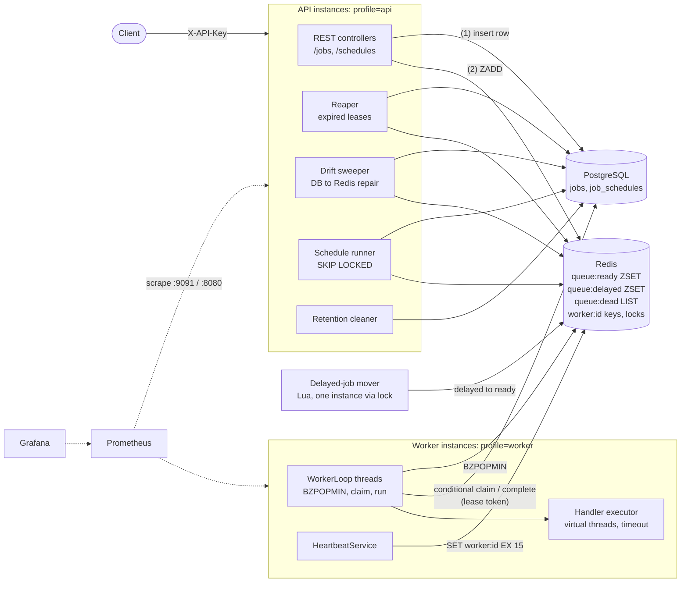
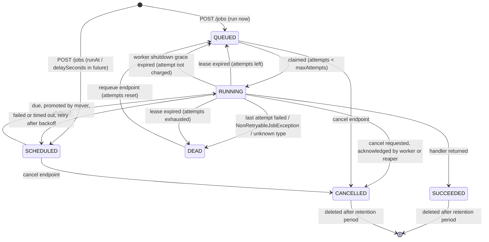
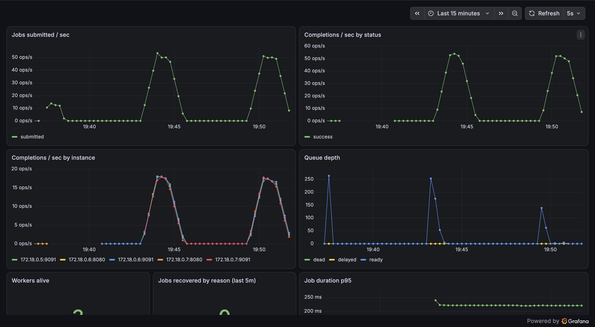

# Distributed Job Scheduler

A distributed background-job system built with Spring Boot 4 and Java 25.

- **PostgreSQL** is the source of truth for every job and schedule.
- **Redis** sorted sets act as the queue, so workers can pull jobs quickly and by priority.
- **API** and **worker** run as separate profiles of the same jar and scale independently.
- The system recovers from crashed workers, hung handlers, Redis data loss, and partial writes.
- Delivery is **at-least-once**.

Features: priorities, retries with exponential backoff and jitter, a dead-letter queue, per-job timeouts, delayed jobs, recurring (cron) schedules, idempotent submission, cancellation, paginated listing, retention, API-key auth, rate limiting, Prometheus metrics, a Grafana dashboard, and Swagger UI.

---

## Contents

- [Architecture](#architecture)
- [Job state machine](#job-state-machine)
- [Delivery guarantee](#delivery-guarantee)
- [Failure scenarios handled](#failure-scenarios-handled)
- [Design trade-offs](#design-trade-offs)
- [Quick start (Docker Compose)](#quick-start-docker-compose)
- [Running from an IDE](#running-from-an-ide)
- [Configuration reference](#configuration-reference)
- [API reference](#api-reference)
- [Observability](#observability)
- [Testing](#testing)
- [Results](#results)
- [Monitoring](#monitoring)
- [Known limitations](#known-limitations)

---

## Architecture



**How a job flows through the system**

1. `POST /jobs` inserts a row (`QUEUED`, or `SCHEDULED` if `runAt` is in the future), then adds the id to `queue:ready` or `queue:delayed`.
2. Each worker thread blocks on `BZPOPMIN queue:ready` (2 s timeout, so it notices shutdown).
3. The worker **claims** the job with a conditional update: `status IN (QUEUED, SCHEDULED) AND attempts < max_attempts`. The update increments `attempts` and sets `worker_id`, a fresh `lease_token` and `lease_expires_at`. If 0 rows change, another worker won and this one moves on.
4. The handler runs on a virtual thread under a per-job timeout. While it runs, the worker renews the lease every 10 s (`worker.lease-renew-interval`; the lease itself is 30 s, computed with the database clock) and checks every second whether a cancel was requested.
5. The result is written with an update that is conditional on `status = RUNNING`, the same `worker_id` **and** the same `lease_token`. A worker that lost the job in the meantime cannot overwrite it.
6. On failure the job becomes `SCHEDULED` with `run_at = now + backoff` and goes into `queue:delayed`. A single lock-guarded mover promotes due entries to `queue:ready` with one atomic Lua script.

Redis key layout:

| Key | Type | Contents |
|---|---|---|
| `queue:ready` | ZSET | job id, score = `priority × 10¹³ + enqueue-ms`; lower pops first (priority 1 = highest) |
| `queue:delayed` | ZSET | job id, score = run-at ms |
| `queue:delayed:priority` | HASH | job id → priority, so promotion needs no DB lookup |
| `queue:dead` | LIST | ids of DEAD jobs (informational; the DB is authoritative) |
| `worker:{id}` | STRING, TTL 15 s | heartbeat, refreshed every 5 s; visibility and metrics only, never a recovery trigger |
| `job:cancel:{id}` | STRING, TTL | fast-path cancel hint for RUNNING jobs |
| `lock:*` | STRING, TTL | leases for singleton tasks (reaper sweeps, mover, retention) |
| `ratelimit:submit:{key}` | HASH | token bucket per API key |

## Job state machine



`SUCCEEDED`, `DEAD` and `CANCELLED` are terminal. The `ck_jobs_status` CHECK constraint keeps the database values in sync with `JobStatus`.

## Delivery guarantee

Delivery is **at-least-once**. A job that is accepted (`201`) will eventually run to `SUCCEEDED` or end up `DEAD`/`CANCELLED`, but **a handler may run more than once for the same job**. This happens when:

- a worker finishes the handler but dies before writing `SUCCEEDED`;
- a lease expires while a slow, partitioned or paused worker is still running the handler;
- a worker cannot reach Postgres for longer than its lease (30 s) while its handler keeps running.

**Handlers must be idempotent.** For example, use the job id as an idempotency key towards downstream systems, or check whether the side effect already happened.

What the system does guarantee: **at most one result is recorded per attempt**, and a worker whose claim was superseded can never overwrite a newer state. The `lease_token` fencing token makes this hold even when a restarted process reuses the same worker id.

## Failure scenarios handled

| Scenario | What happens | Bounded by |
|---|---|---|
| **Worker crash** (SIGKILL, OOM, host loss) | The worker stops renewing its leases. The reaper (every 10 s, Redis-locked) finds RUNNING jobs whose `lease_expires_at < now()` (database clock) and re-queues them with a conditional update (`status = RUNNING AND worker_id AND lease_token AND lease still expired`). A job that finished, or whose lease was renewed, in the meantime is never touched. The heartbeat only labels the cause (`worker lost (lease expired)`). | lease 30 s + reaper interval 10 s |
| **Poison pill** (job that kills every worker that runs it) | Each crash uses up one attempt, because the claim increments `attempts`. Once `attempts ≥ maxAttempts`, the reaper marks it `DEAD` ("worker lost (lease expired); max attempts exhausted") and `claim()` refuses it. | `maxAttempts` |
| **Hung handler** | Runs under `Future.get(timeout)`. On timeout it is cancelled (interrupted) and treated as a failure with message `timeout` (retry or DEAD); `jobs_timeout_total` counts these. | `timeoutSeconds` (default 300) |
| **Hung / partitioned worker** (alive heartbeat, but not making progress or unable to reach Postgres) | The lease stops being renewed. Recovery is driven by lease expiry alone, so the reaper re-queues the job even though the heartbeat is alive. If the old worker comes back, its completion fails the fencing check and it stops its handler. | `worker.lease-seconds` (30) |
| **Redis wipe / failover without persistence** | Postgres is authoritative. The drift sweeper finds QUEUED/SCHEDULED jobs that are missing from both ZSETs and re-enqueues them at their `run_at`. It pages by id, checks each page with one Lua call, waits once, re-checks, and uses a conditional "touch" before each re-enqueue. Losing the `worker:*` heartbeat keys does **not** trigger any recovery, because recovery is lease-based. AOF (`--appendonly yes`) makes plain restarts lossless. | `sweeper.stale-after` (60 s) + sweep interval |
| **API crash between DB commit and `ZADD`** | The row exists but is not in Redis. The drift sweeper picks it up once it is older than `stale-after`. The schedule runner has the same window and is covered the same way. | ~60–70 s |
| **Worker dies between `BZPOPMIN` and claim** | Same as above: the job is still QUEUED in Postgres but gone from Redis, so the sweeper restores it. | ~60–70 s |
| **Duplicate pop** (same id in Redis twice, two workers pop it) | Only one conditional `claim` can succeed; the other is a no-op (`jobs_duplicate_skipped_total`). | — |
| **Reaper racing a worker** (reads RUNNING, the worker then succeeds) | The reaper's update requires the state it read (RUNNING, same worker and token), so it changes 0 rows and does nothing. | — |
| **Rolling deploy / scale-down** (SIGTERM) | `WorkerLoop` (a `SmartLifecycle`) stops polling immediately and lets in-flight jobs run for `shutdown-grace-seconds` (25 s). After that it interrupts them and puts them back to QUEUED **without charging the attempt**. The heartbeat stops only after the drain. Compose allows `stop_grace_period: 30s`. | 25 s |
| **Duplicate submission** (client retry) | `Idempotency-Key` header: the unique column plus `INSERT … ON CONFLICT DO NOTHING` returns the original job with `200`. | — |
| **Two API instances firing the same cron** | `SELECT … FOR UPDATE SKIP LOCKED` on due schedules, plus the per-fire idempotency key `schedule:{id}:{fireTime}`. | — |

## Design trade-offs

**Why a Redis sorted set rather than Postgres `SELECT … FOR UPDATE SKIP LOCKED` as the queue?**

| | Redis ZSET (chosen) | Postgres SKIP LOCKED |
|---|---|---|
| Dequeue | `BZPOPMIN` blocks and wakes instantly: no polling and no load on the DB while idle | Workers must poll; each poll is a query plus a row lock |
| Priority + FIFO | One score, O(log n) | Index on `(status, priority, run_at)`; fine, but it churns |
| Delayed jobs | Second ZSET plus an atomic Lua mover | `run_at <= now()` in the poll query (simpler) |
| Hot-path DB load | One conditional `UPDATE` per claim | `SELECT … FOR UPDATE` + `UPDATE`, plus bloat and vacuum pressure on a hot table |
| Consistency | **Two systems** that can drift, so a drift sweeper is needed and delivery is at-least-once | Enqueue is transactional with the business write: no drift and no sweeper |
| Operations | Extra stateful service (AOF, memory sizing) | Nothing new |

The Redis design is chosen to keep the dequeue path off Postgres and to show the recovery mechanics. Honestly, for modest throughput (hundreds of jobs per second) SKIP LOCKED alone would be simpler and fully transactional. That is why the **schedule runner** uses SKIP LOCKED: it has low volume and needs exactly-once fires.

Other choices:

- **Fencing token instead of `attempts`.** `attempts` is decremented when a shutdown hands a job back, so it can repeat. A random UUID per claim cannot.
- **Lease as the single recovery authority.** A RUNNING job is recovered only when its lease (30 s, renewed every 10 s) has expired by the **database clock**. That one rule covers crashed, stuck and partitioned workers alike, and it means losing Redis heartbeats can never cause a requeue. The heartbeat (`worker:{id}`) remains for the `workers_alive` gauge and to label recoveries. The trade-off is slower crash detection (up to ~40 s instead of ~25 s).
- **Cooperative cancellation.** Java cannot safely kill a thread. A RUNNING job is interrupted, and the handler must respond to interrupts. Lease renewal is refused while `cancel_requested` is set, so the worker notices even if the Redis hint is lost.
- **Full-jitter backoff** (`random(0, min(cap, base·2^attempt))`). This spreads out jobs that failed together, for example during a downstream outage.
- **Retries are `SCHEDULED`** because they are future-dated, which keeps the state machine uniform.
- **Misfire policy for cron: run once, skip missed runs.** After downtime, a schedule fires once (for the earliest missed time). It does not replay a backlog.

## Quick start (Docker Compose)

```bash
cp .env.example .env        # then edit every "change-me" value
docker compose up -d --build --scale worker=3
```

| Service | URL | Notes |
|---|---|---|
| API | http://localhost:8080 | send `X-API-Key: <one of API_KEYS>` |
| Swagger UI | http://localhost:8080/swagger-ui.html | click **Authorize** and enter an API key |
| Prometheus | http://127.0.0.1:9090 | bound to localhost only |
| Grafana | http://127.0.0.1:3000 | `GRAFANA_ADMIN_USER` / `GRAFANA_ADMIN_PASSWORD`; *Job Scheduler* dashboard is provisioned |

```bash
curl -s -X POST localhost:8080/jobs -H "X-API-Key: $API_KEY" -H 'Content-Type: application/json' \
     -d '{"type":"EMAIL","payload":"hello","priority":1}'
```

Postgres, Redis and the API's actuator port (9091) are **not published** to the host. To reach them, edit `docker-compose.override.yml` (Compose merges it automatically).

> **Upgrading an existing deployment:** `POSTGRES_PASSWORD` only takes effect when the `pgdata` volume is first created. If you already have a volume from the old setup (password `jobs`), either set `POSTGRES_PASSWORD=jobs` in `.env` or recreate the volume. Flyway applies migrations V2–V4 on startup.

## Running from an IDE

Start Postgres and Redis with the ports enabled in `docker-compose.override.yml`. Then run `JobschedulerApplication` with:

- API: `-Dspring.profiles.active=api` and env `DB_PASSWORD`, `REDIS_PASSWORD`, `API_KEYS`. Actuator is served on `MANAGEMENT_PORT` (default 9091).
- Workers: `-Dspring.profiles.active=worker -DPORT=8081 -DWORKER_ID=worker-1` plus `DB_PASSWORD`, `REDIS_PASSWORD`.

Logs are ECS JSON. Pipe them through `jq` to read them locally.

## Configuration reference

Every property can be set as an environment variable using Spring's relaxed binding, e.g. `worker.lease-seconds` → `WORKER_LEASE_SECONDS`.

**Connections and credentials**

| Env var | Default | Description |
|---|---|---|
| `DB_URL` | `jdbc:postgresql://127.0.0.1:5433/jobs` | JDBC URL |
| `DB_USER` | `jobs` | DB user |
| `DB_PASSWORD` | *(empty)* | DB password |
| `REDIS_HOST` / `REDIS_PORT` | `localhost` / `6379` | Redis address |
| `REDIS_PASSWORD` | *(empty)* | Redis `requirepass` |
| `API_KEYS` | *(required for api)* | comma-separated accepted `X-API-Key` values; the API refuses to start without one |
| `MANAGEMENT_PORT` | `9091` | API actuator port (health, prometheus) |
| `PORT` | `8081` | worker HTTP port (actuator only) |
| `WORKER_ID` | `worker-${PORT}` | must be unique per worker process (Compose uses the hostname) |
| `WORKER_CONCURRENCY` | `4` | job-processing threads per worker |

**Worker (`worker.*`)**

| Property | Default | Description |
|---|---|---|
| `default-timeout-seconds` | `300` | timeout for jobs submitted without `timeoutSeconds` |
| `lease-seconds` | `30` | lease length, computed as database `now() + lease` |
| `lease-renew-interval` | `10s` | how often a running job renews its lease; must be shorter than the lease |
| `shutdown-grace-seconds` | `25` | drain time on shutdown before in-flight jobs are interrupted and returned |
| `base-backoff-seconds` | `1` | backoff base |
| `max-backoff-seconds` | `300` | backoff cap (full jitter below it) |
| `poll-timeout` | `2s` | `BZPOPMIN` timeout |

**Scheduler / maintenance (`scheduler.*`)**

| Property | Default | Description |
|---|---|---|
| `retention-days` | `7` | delete SUCCEEDED/CANCELLED jobs whose `completed_at` is older than this |
| `retention-batch-size` | `1000` | rows per DELETE |
| `retention-interval` | `1h` | how often retention runs |
| `max-schedule-ahead` | `365d` | furthest allowed `runAt` |
| `cancel-hint-ttl` | `1h` | TTL of the Redis cancel hint |
| `schedules.poll-interval` | `1s` | how often due cron schedules are checked |
| `schedules.batch-size` | `100` | schedules locked per transaction |
| `sweeper.stale-after` | `60s` | jobs younger than this are not drift-checked |
| `sweeper.recheck-delay` | `2s` | wait between the two membership checks |
| `sweeper.page-size` | `500` | ids per DB page / Lua call |
| `sweeper.max-candidates` | `50000` | missing ids held per sweep; the rest go in the next sweep |
| `sweeper.lock-ttl` | `60s` | sweep lock TTL, renewed per page |
| `mover.batch-size` | `1000` | delayed → ready members moved per Lua call |
| `mover.lock-ttl` | `5s` | mover lock TTL |
| `scheduling-enabled` | `true` | turn off all background tasks (used by tests) |

**Security (`security.*`)**

| Property | Default | Description |
|---|---|---|
| `api-keys` | `${API_KEYS}` | accepted keys |
| `rate-limit.enabled` | `true` | token bucket on `POST /jobs` |
| `rate-limit.capacity` | `200` | burst size per key (Compose: `RATE_LIMIT_CAPACITY`) |
| `rate-limit.refill-per-second` | `50` | sustained rate per key (Compose: `RATE_LIMIT_REFILL_PER_SECOND`) |

Fixed values: heartbeat TTL 15 s (refreshed every 5 s; visibility only); reaper and drift sweeps every 10 s; mover every 500 ms; `spring.lifecycle.timeout-per-shutdown-phase: 40s`.

## API reference

All `/jobs/**` and `/schedules/**` endpoints require `X-API-Key`. Errors are RFC 7807 `application/problem+json`. The full spec is at `/v3/api-docs`, with an interactive UI at `/swagger-ui.html`.

### Jobs

| Method & path | Description | Success |
|---|---|---|
| `POST /jobs` | Submit a job. Optional `Idempotency-Key` header (≤ 200 chars). | `201` + `Location` (new), `200` (key seen before, original job returned) |
| `GET /jobs/{id}` | Get one job | `200`, `404` |
| `GET /jobs` | Paged list: `page` (0-based), `size` (1–100, default 20), filters `status` (repeatable), `type`, `workerId`, `createdFrom`, `createdTo` (ISO-8601). Newest first. | `200` `{content, page, size, totalElements, totalPages}` |
| `GET /jobs/dead` | All DEAD jobs | `200` |
| `GET /jobs/stats` | Counts by status, successes by worker | `200` |
| `POST /jobs/{id}/cancel` | QUEUED/SCHEDULED: cancelled now. RUNNING: cancel requested, and the worker interrupts the handler. | `200` (cancelled), `202` (requested), `409` (already terminal), `404` |
| `POST /jobs/{id}/requeue` | DEAD → QUEUED; resets attempts, clears `lastError`, removes the id from `queue:dead` | `200`, `409` (not DEAD), `404` |

`POST /jobs` body:

| Field | Type | Rules |
|---|---|---|
| `type` | string | required; must match a registered `JobHandler` (currently `EMAIL`) |
| `payload` | string | ≤ 64 KB UTF-8 |
| `priority` | int | 1 (highest) – 10, default 5 |
| `maxAttempts` | int | 1–20, default 3 |
| `timeoutSeconds` | int | 1–86400, default `worker.default-timeout-seconds` |
| `runAt` | ISO-8601 instant | optional; future → `SCHEDULED`; past → runs now |
| `delaySeconds` | long | optional, 0–31536000; mutually exclusive with `runAt` |

`POST /jobs` is rate limited per API key. When the bucket is empty you get `429` with `Retry-After`. Responses carry `X-RateLimit-Limit` / `X-RateLimit-Remaining`.

The demo `EMAIL` handler sleeps 500 ms, or `delayMs=N` if the payload contains that. A payload containing `fail` throws.

### Schedules

| Method & path | Description | Success |
|---|---|---|
| `POST /schedules` | Create: `name` (unique), `cron`, `timezone` (IANA, default UTC), `type`, `payload`, `priority`, `maxAttempts`, `timeoutSeconds`, `enabled` | `201`, `400`, `409` (duplicate name) |
| `GET /schedules` | Paged list (`page`, `size` ≤ 100) | `200` |
| `GET /schedules/{id}` | Get one | `200`, `404` |
| `PATCH /schedules/{id}` | Partial update; changing `cron`/`timezone`/`enabled` recomputes `nextRunAt` from now | `200` |
| `DELETE /schedules/{id}` | Delete; past runs are kept, with `cronScheduleId` set to null | `204` |
| `POST /schedules/{id}/pause` / `resume` | Disable / enable; resume does **not** back-fill missed runs | `200` |

`cron` accepts Spring's 6-field format (`sec min hour day month weekday`), classic 5-field Unix cron (which gets `0` seconds), and macros such as `@hourly` and `@daily`. Each fire creates one job with idempotency key `schedule:{id}:{fireTime}`.

### Extending: adding a job type

Implement `JobHandler` as a Spring bean:

```java
@Component
class ResizeImageHandler implements JobHandler {
    public String type() { return "RESIZE_IMAGE"; }
    public void handle(String payload) throws Exception {
        // must be idempotent and respond to interrupts (timeouts, cancel, shutdown)
        // throw NonRetryableJobException for permanent failures -> straight to DEAD
    }
}
```

The handler must be on the classpath of both the API (which validates `type`) and the workers.

## Observability

**Metrics** (`/actuator/prometheus`; API on the internal port 9091, workers on 8080):

| Metric | Type | Notes |
|---|---|---|
| `jobs_submitted_total` | counter | |
| `jobs_completed_total{status}` | counter | `success`, `retry`, `dead`. No per-worker tag: Prometheus adds `instance` |
| `jobs_timeout_total` | counter | handler exceeded its timeout |
| `jobs_cancelled_total` | counter | |
| `jobs_recovered_total{reason}` | counter | `worker_lost`, `lease_expired`, `missing_from_queue` |
| `jobs_duplicate_skipped_total` | counter | popped but not claimable |
| `schedule_runs_created_total` | counter | |
| `job_duration_seconds` | histogram | handler run time |
| `job_queue_wait_seconds` | histogram | from `runAt` (or `createdAt`) to claim |
| `queue_depth{queue}` | gauge | ready / delayed / dead (API) |
| `workers_alive` | gauge | live heartbeat keys (API); informational, not used for recovery |

**Logs** are ECS JSON (`logging.structured.format.console: ecs`). Every log line written while a job is being processed has `jobId`, `workerId` and `attempt` in the MDC, including lines logged by the handler on its own thread.

## Testing

```bash
./mvnw test      # unit + integration tests; needs only a running Docker daemon
./mvnw verify    # what CI runs (.github/workflows/ci.yml)
```

Integration tests start throw-away `postgres:16` and `redis:7` containers through Testcontainers `@ServiceConnection`; no local Postgres or Redis is needed. Background `@Scheduled` tasks are disabled in tests (`scheduler.scheduling-enabled=false`) so tests can call the sweeps deterministically. Coverage includes:

- worker unit tests: retry/backoff, DEAD, non-retryable, unknown type, timeout, lease renewal and loss, cancellation, graceful shutdown, MDC, metrics;
- Testcontainers tests: the reaper not overwriting a SUCCEEDED job, a poison pill ending DEAD, lease-expiry recovery, fencing, sweeper repair across pages, the Lua mover, idempotency races, SKIP LOCKED schedule firing, retention, security and rate limiting;
- an end-to-end test that runs a real worker context.

**Scripts** (against the Compose stack; need `curl`, `jq`, and `API_KEY` exported):

```bash
export API_KEY=<one of API_KEYS>
./scripts/load_test.sh            # JOB_COUNT=1000 JOB_DELAY_MS=200 CONCURRENCY=20 by default
./scripts/fault_tolerance_test.sh # submits 4 x 20 s jobs, SIGKILLs the busiest worker, verifies recovery
```

`load_test.sh` retries `429`s and reports how many it got. Raise `RATE_LIMIT_CAPACITY` / `RATE_LIMIT_REFILL_PER_SECOND` in `.env` to measure raw throughput.

`fault_tolerance_test.sh` kills a worker container with SIGKILL by default (`KILL_MODE=docker`), because a graceful stop drains jobs and would not show recovery. Use `KILL_MODE=manual` for IDE-launched workers and `kill -9` them yourself. `PASS` requires every job to succeed, at least one recovery (`worker lost` / `lease expired`), and the `SUCCEEDED` count to grow by exactly the number of jobs submitted.

## Results

Measured on 2026-11-20 against the Docker Compose stack, using `scripts/load_test.sh` and `scripts/fault_tolerance_test.sh` with their defaults.

**Test environment:** 3 workers × `WORKER_CONCURRENCY=4` threads (12 job threads), `JOB_DELAY_MS=200`, 20 concurrent submitters, rate limit `RATE_LIMIT_CAPACITY=200` / `RATE_LIMIT_REFILL_PER_SECOND=50` · Apple M4 (10 cores), 16 GiB RAM (17,179,869,184 bytes), macOS 27.0.1 (26A434) · Docker Desktop 29.9.3 with VM limits of 10 CPUs and 8,319,438,848 bytes of memory.

### Load test (1,000 jobs)

| Metric | Value |
|---|---|
| Jobs submitted | 1,000 (all accepted) |
| Submission time | 16 s |
| Submission rate | 62.50 submissions/s |
| `429` responses (retried by the script) | 189 |
| End-to-end time (first submit → 1,000th terminal job) | 22 s |
| End-to-end throughput | 45.45 jobs/s |
| Outcome | 1,000 SUCCEEDED, 0 DEAD |

The submission rate is bounded by the per-key rate limit (50 tokens/s after a 200-request burst), not by the API, so these numbers describe the throttled path. Raise `RATE_LIMIT_*` in `.env` to measure raw capacity.

Per-worker split of the 1,000 jobs (from `/jobs/stats` → `succeededByWorker`):

| Worker (container id) | Jobs succeeded |
|---|---|
| `d86ffa237f56` | 333 |
| `d65929aef483` | 330 |
| `0aca59a01614` | 337 |

### Fault test (worker SIGKILL)

| Metric | Value |
|---|---|
| Result | **PASS** |
| Jobs submitted | 4 × 20 s jobs (`JOB_DELAY_MS=20000`) |
| Worker killed | `0aca59a01614` (held 2 RUNNING jobs) |
| Recovered jobs | 2, `lastError = "worker lost (lease expired)"`, succeeded on attempt 2 on the surviving workers |
| Other jobs | 2 succeeded on attempt 1 |
| Crash → recovered jobs re-claimed | ≈31 s (SIGKILL at ≈14:08:10 UTC; re-claimed ≈14:08:41, derived as `completedAt` 14:09:01.0 minus the 20 s handler) |
| Crash → recovered jobs completed | ≈51 s |
| Final `/jobs/stats` | only `SUCCEEDED`: 0 QUEUED, RUNNING, SCHEDULED or DEAD |

The ≈31 s matches the design: the killed worker claimed the jobs at ≈14:08:08 and had not renewed them yet, so their 30 s leases expired at ≈14:08:38, and the next reaper tick (every 10 s) re-queued them.

## Monitoring



*The provisioned Grafana "Job Scheduler" dashboard (http://127.0.0.1:3000) during a `load_test.sh` run: submission and completion rates, completions per instance, queue depth, live workers, recoveries, job duration and queue-wait percentiles, timeouts/cancellations and schedule runs.*

## Known limitations

- **At-least-once only.** Handlers must be idempotent (see above).
- **Interrupt-deaf handlers.** A handler that ignores interrupts keeps running on its virtual thread after a timeout or cancel. Its result is discarded (fencing), but it still uses CPU and may produce side effects.
- **Recovery latency.** Jobs lost between a DB commit and the Redis write, or between pop and claim, wait for `sweeper.stale-after` (60 s) before re-enqueue.
- **Crash detection takes up to ~40 s** (30 s lease + 10 s reaper interval). Lower `worker.lease-seconds` and `worker.lease-renew-interval` together for faster recovery, at the cost of more DB writes.
- **Partitioned workers can cause duplicate runs.** A worker cut off from Postgres for longer than its lease keeps running its handler while the job is re-queued elsewhere. The stale result is fenced off, but the side effects happen twice.
- **Clock assumptions.** Leases are set, renewed and checked with the database clock, and `claim` compares `run_at` to database `now()`, so JVM clock skew cannot expire a lease early or start a job before it is due. Retry `run_at` and Redis delayed-queue scores are still computed from the worker's clock. If a worker's clock runs ahead, a retry may be promoted early; `claim` then refuses it and the worker puts it back in the delayed queue, so the only cost is a short delay. The rate limiter uses Redis' clock.
- **Single Redis.** No Redis Cluster/Sentinel configuration is included.
- **Handler registry is shared.** The API validates `type` against the handlers on its own classpath, so API and workers must ship the same handler set.
- **API keys are static** (environment config): no per-key scopes, rotation endpoint or key store.
